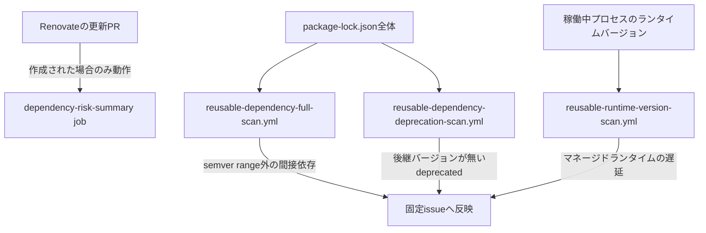
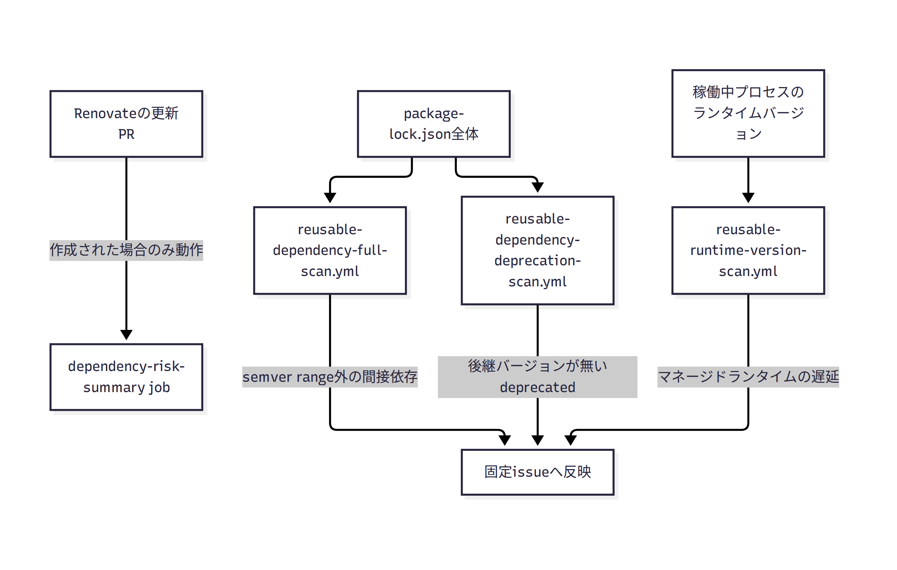

# 依存更新Risk判定：定期リスクチェック

本ドキュメントは、依存更新PRの作成を待たずに動作する定期スキャンの仕組みを扱う。本仕組み全体の位置関係・外部データソース一覧は[`dependency-risk-judgment.md`](dependency-risk-judgment.md)を参照する。PR単位で動作する判定ロジック（`dependency-risk-summary` job本体）は[`dependency-risk-judgment-renovate-logic.md`](dependency-risk-judgment-renovate-logic.md)を参照する。

## Renovateの提案に依存しない推移的依存のセーフティネット（[#1094](https://github.com/bamiyanapp/dev-standards/issues/1094)・[#1095](https://github.com/bamiyanapp/dev-standards/issues/1095)）

[`dependency-risk-judgment-renovate-logic.md`](dependency-risk-judgment-renovate-logic.md)の仕組みは、いずれもRenovateが更新PRを作成した時点で初めて動作する。Renovateは基本的に直接依存の`package.json`に明記されたバージョン制約のみを更新対象とするため、間接依存（推移的依存）は親パッケージのsemver range内で解決される。親パッケージ自体の更新PRが来ない限り、間接依存側の脆弱性修正・放置はRenovate経由では検知されない。この片側だけのチェック体制を補うため、以下の2つを独立に用意している。

- **`renovate.json`の`lockFileMaintenance`**（issue #1094）: 週次でlockfile全体を再生成するPRを作成する。親パッケージのバージョン範囲内で解決可能な新しいバージョンへ、Renovateが提案を出さなくても定期的に取り込まれるようになる
- **`reusable-dependency-full-scan.yml`**（issue #1095）: `dependency-risk-summary` jobはPRに対して動作する。その対象は`package-lock.json`差分のみである。本機能はそれとは独立に動作する。呼び出し元リポジトリの`package-lock.json`全体を定期スキャンする。`scripts/dependency-full-scan.js`が全パッケージ（直接・間接問わず）を抽出する。既存の`dependency-vulnerability-info.js`（OSV.dev照会）を再利用して脆弱性を検知する。検知した場合、固定タイトルの単一Issueへ結果を反映する。これはdependency-deprecation-scan（issue #969）と同じ設計であり、実行毎に新規Issueを積み重ねない。`reusable-ci.yml`同様のreusable workflowとして提供する。参照側リポジトリ（karuta等）が独自のscheduleトリガー付きworkflowから呼び出す構成とする
  - **スキャン対象は本番コードから到達可能な依存のみ**（issue #1288）: `package-lock.json`の各エントリは`dev`フラグを持つ。これはnpmが付与するフラグで、devDependencies経由のみ（本番コードから到達不可能）であることを意味する。全ての出現箇所が`dev: true`であるパッケージは、OSV照会自体を行わない（同一name+versionが複数箇所に存在する場合、1箇所でも本番到達経路があれば対象に含める）。`eslint`・`@lhci/cli`・`semantic-release`等のdevDependencies配下のみに存在する脆弱性は、実行時のアプリケーションコードへ一切露出しない。これを無視すると、対応不要な項目が毎回issueに列挙され続けるノイズになっていた。devDependencies側のサプライチェーンリスク（新規install script検知等）は、本スキャンの対象外である。上述のSupply Chainチェックという別の関心事で扱う（[`dependency-risk-judgment-renovate-logic.md`](dependency-risk-judgment-renovate-logic.md)「Supply Chainチェック」参照）

### 3つの定期スキャン系セーフティネットの関係（issue #1174）

PRに依存しない定期スキャンは、上記の`reusable-dependency-full-scan.yml`以外にも2つある。`reusable-dependency-deprecation-scan.yml`は[`dependency-risk-judgment-renovate-logic.md`](dependency-risk-judgment-renovate-logic.md)「deprecated（サポート終了）検知」節を参照する。`reusable-runtime-version-scan.yml`は[`reusable-workflows-reference.md`](reusable-workflows-reference.md)を参照する。3つはいずれも「Renovateの更新PRが来るまで何も検知しない」という同じ構造的な弱点を補う。対象・補うギャップはそれぞれ異なるため、一覧性を上げるためここで並べて示す。

| スキャン | 対象 | 補うギャップ |
|---|---|---|
| `reusable-dependency-full-scan.yml` | `package-lock.json`全体（直接・間接問わず） | 間接依存が親パッケージのsemver range外の更新を必要とするケース |
| `reusable-dependency-deprecation-scan.yml` | `package-lock.json`全体（既定で直接依存のみ） | 後継バージョンが存在せず、Renovateが更新PRを作れないケース |
| `reusable-runtime-version-scan.yml` | 稼働中プロセスが報告するランタイム（Node.js等）のバージョン | マネージドランタイム自体（npmパッケージの管轄外、karuta#1880） |

<!-- jscpd:ignore-start -->

ソースを表示（mermaid記法）

（mermaid記法のソースは畳み込んで維持し、下に`enable_mermaid_render`の再レンダリング画像を貼る理由・運用は[`documentation-format-conventions.md`](documentation-format-conventions.md)「`enable_mermaid_render`との関係」を参照）

<!-- jscpd:ignore-end -->

`lockFileMaintenance`は、あくまで親パッケージのバージョン範囲内で解決可能な更新のみをカバーする。親パッケージ自体が古すぎて、より新しい間接依存を許容しない（range外にある）ケースは`lockFileMaintenance`だけでは検知できない。この残存ギャップを`reusable-dependency-full-scan.yml`が補う。

本機能は「検知して起票/更新する」までを担い、修正PRの自動作成は対象外とする。推移的依存は親パッケージの期待するバージョン範囲内にあるため、機械的に1パッケージだけ安全に更新する手段が無く、不適切な自動変更で動作を崩すリスクがあるためである。起票するIssue本文には、親パッケージの更新待ち・`package.json`の`overrides`での強制固定・採用自体の見直しを対応候補として記載し、人間の判断に委ねる。

**既知の限界（残存する検知ラグ・情報源の範囲）**。`reusable-dependency-full-scan.yml`自体は`workflow_call`のみでscheduleトリガーを持たない。実行頻度は呼び出し元リポジトリ（karuta等）が用意するcron設定に依存する。新しいCVEが公開されてから次回スキャンまでのラグは、呼び出し元の設定次第で生じる（例: 週1回呼び出す場合、最大1週間弱のラグが生じ得る）。また、本機能の脆弱性照会は`dependency-vulnerability-info.js`経由のOSV.devのみに依拠する。適用リスク側（`classifyRisk()`）が別途使うCISA KEVは、本フルスキャン側では使っていない。いずれも「検知するが直さない」という上記の設計上の割り切りと同種の、受容された既知の限界である。

**Renovate対応中PRの重複検知対策（issue #1163）**。フルスキャンはRenovateが既に対応PRを作成済みかどうかを元々見ていなかった。`minimumReleaseAge`待機中・Human Review待ち等のPRが既に存在する脆弱性も「新規検知」として重複して固定issueへ反映してしまう問題があった。パッケージ名をタイトルに含むopenなPRが存在する場合、issue本文の「対応PR」列へその番号を記載するようにした（`findRelatedPullRequest()`）。タイトル文字列の部分一致による簡易な判定のため、誤検出（無関係なPRが偶然同じ文字列を含む等）の可能性は残る。あくまで人間の判断を補助する目安であり、修正PRの自動作成・自動クローズの判断には使わない。

## dev-standards自身のリリースにおけるRisk判定履歴の生成（issue #746 Phase 2）

dev-standards自体の依存更新を考える。Renovate等によるPRがmainへマージされ、semantic-releaseが新バージョンをリリースする際のRisk判定結果を記録したい。各プロダクトリポジトリ（karuta等）が参照できるよう`docs/generated/dependency-risk-history.json`へ機械可読な形で残す。プロダクト側がこの履歴を読み出して利用する処理は[`dependency-risk-judgment-renovate-logic.md`](dependency-risk-judgment-renovate-logic.md)「プロダクト側（karuta等）での利用」を参照する。

- `reusable-cd.yml`の`release` jobへステップを追加した。dev-standards自身（`github.repository == 'bamiyanapp/dev-standards'`）の場合のみ実行される
- このステップは前回リリースタグとの`package-lock.json`差分から判定材料を再計算する。判定材料とはupdate type・install script異常・メンテナ変化・CVE/CVSS/EPSS/KEVである。これらはPR作成時の`dependency-risk-summary` jobと同じ材料である
- 外部API呼び出し（OSV.dev・CISA KEV・npm registry）を含むため、一時的な障害でリリース自体を失敗させないようこのステップ全体を`continue-on-error`にする
- 計算結果は`scripts/append-dependency-risk-history.js`が`docs/generated/dependency-risk-history.json`へ追記する。この追記はリリースコミットへ含める
- このスクリプトはsemantic-releaseの`changelogPrepareCmd`から`${nextRelease.version}`付きで呼ばれる
- このスクリプトはどのような内部エラーが起きても必ず正常終了する。`changelogPrepareCmd`の失敗は`@semantic-release/git`によるコミット自体を止めてしまうため、安全側に倒す
- ファイルの形式: `{ version, date, riskLevel, riskReasons, staleRiskLevel, staleRiskReasons }`の配列。同一`version`への再追記は上書きする（リトライ時の重複防止）
- 初回リリース等、比較対象となる前回タグが存在しない場合は追記自体をスキップする
