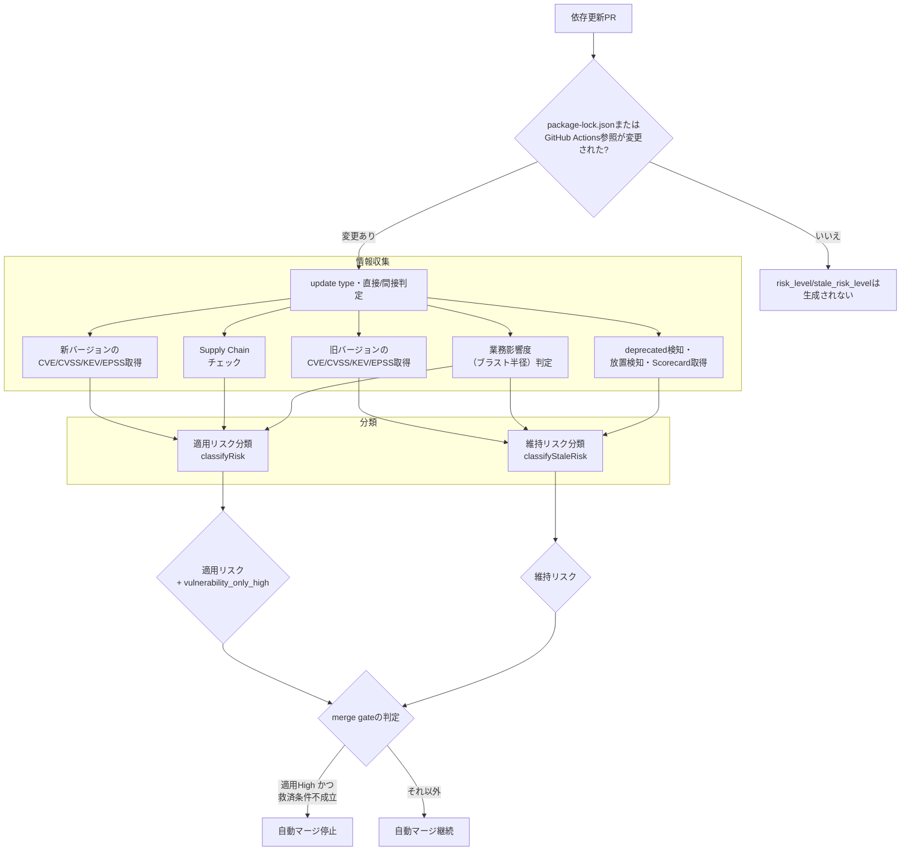
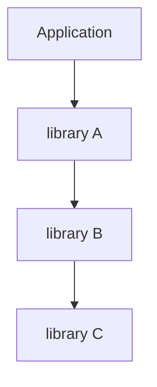
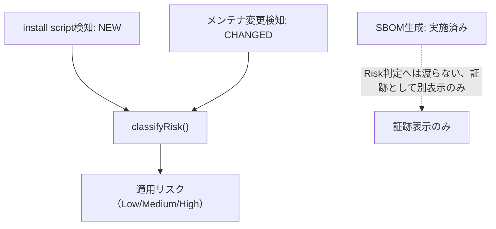
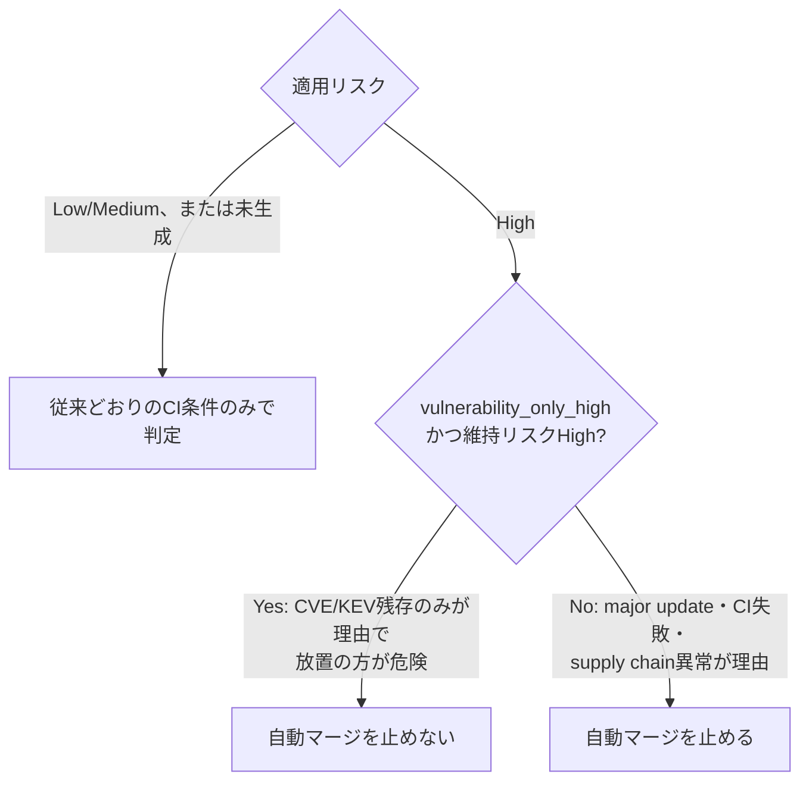

# 依存更新Risk判定

`reusable-ci.yml`の`dependency-risk-summary` job（`enable_dependency_risk_summary`・`enable_dependency_risk_gating`入力）が、依存更新PRに対して行うリスク判定の詳細を扱う。背景はissue #645「OSS依存更新の自動安全判定・エスカレーション基盤」（[bamiyanapp/dev-standards#645](https://github.com/bamiyanapp/dev-standards/issues/645)）を参照。両入力自体の一覧（デフォルト値等）は[`reusable-workflows-reference.md`](reusable-workflows-reference.md)を参照する。

以下は、判定フロー全体を分岐を含む処理フローとして可視化したもの（[bamiyanapp/dev-standards#695](https://github.com/bamiyanapp/dev-standards/issues/695)）。本ドキュメントの各節がどこに対応するかの目次としても使える。個別の昇格ルールの詳細は本ドキュメントの各節、および`scripts/dependency-risk-classifier.js`のコードコメントを正本とし、ここでは全体構造のみを示す。

<!-- jscpd:ignore-start -->

ソースを表示（mermaid記法）

（mermaid記法のソースは畳み込んで維持し、下に`enable_mermaid_render`の再レンダリング画像を貼る理由・運用は[`documentation-format-conventions.md`](documentation-format-conventions.md)「`enable_mermaid_render`との関係」を参照）

<!-- jscpd:ignore-end -->

## Risk Summaryの投稿（`enable_dependency_risk_summary`）

`package-lock.json`・`.github/workflows/*.yml`・`.github/actions/*/action.yml`のいずれかが変更されたPRで、以下をまとめたRisk Summaryを投稿する。Phase 1は[#646](https://github.com/bamiyanapp/dev-standards/issues/646)、Phase 3は[#648](https://github.com/bamiyanapp/dev-standards/issues/648)を参照。Renovate等が作成した依存更新PRのリスク判断を、人間が調査を始める前に補助する情報を用意するのが目的。各ステップは`continue-on-error: true`のため、このjobの失敗が`merge` jobをブロックすることはない。

- **update type・直接/間接判定**（CVE/CVSS/EPSS/KEV・CI結果・ファンアウト（dev-standards自体の更新の場合）の算出元にもなる、詳細は次節）
- GitHub Actions/reusable workflow参照の更新（dev-standards自体を含むworkflow参照のバージョン更新）
- **Supply Chainチェック**（新規install script・メンテナ変更・SBOM、詳細は次々節）
- **業務影響度（ブラスト半径）**: 変更された直接依存のimport元が、重要パスに該当する場合を考える。重要パスはリポジトリルートの`dependency-risk-critical-paths.json`（`{"criticalPaths": ["frontend/src/payment/"]}`形式、パスのprefix文字列でglobは使わない）で宣言する。該当する場合、適用リスクを1段階昇格する。宣言が無い場合は昇格しない（[#689](https://github.com/bamiyanapp/dev-standards/issues/689)）

## update type・直接/間接判定（`dependency-update-info.js`）

更新前後2つの`package-lock.json`を比較し、変更されたパッケージごとに以下を判定する。後続の適用リスク分類（`classifyRisk()`）・維持リスク分類（`classifyStaleRisk()`）・業務影響度（ブラスト半径）判定は、いずれもこの判定結果を入力として使う。

- **update type**: 新旧バージョンのsemver（major.minor.patch）を比較し、`major`/`minor`/`patch`のいずれかに分類する。プレリリース等でバージョン比較ができない場合・バージョンが不変の場合・ダウングレードの場合は`other`として扱う。`other`はRisk判定側で保守的にHigh相当として扱う
- **直接/間接判定**: `package-lock.json`のルートエントリ（`packages[""]`）が宣言する依存であれば直接依存とする。npm workspaces構成（`packages[""].workspaces`）の場合は、各ワークスペースメンバー自身の`package.json`が宣言する依存も合算する（karutaの実環境で、この合算が漏れており全依存が常に「間接」と誤分類されていたことが発覚し修正した。[#720](https://github.com/bamiyanapp/dev-standards/issues/720)参照）。業務影響度（ブラスト半径）判定は、直接依存のみを対象にする

## Supply Chainチェック（[#648](https://github.com/bamiyanapp/dev-standards/issues/648) Phase 3）

CVE/CVSS/KEVチェック（上記）は「既知の脆弱性があるかどうか」を見る。Supply Chainチェックはこれとは別の観点で、OSSパッケージそのものに不自然な変化が無いかを見る。CVEが0件でも、install script追加や公開者変更等の別のリスクシグナルが存在し得るため、両方を独立に見る。

**重要**: いずれの検知結果も、悪性であることを証明するものではない。通常のバージョン更新では見落としやすい変化を検出し、人間による確認が必要かどうかを判断するための**シグナル**である。「検知＝Riskを上げる材料」ではあるが、「検知＝即危険」ではない。

| チェック | 検知対象 | Riskへの使い方 |
|---|---|---|
| 新規install script | インストール時に実行されるコードの有無の変化（`package-lock.json`の`hasInstallScript`フラグ比較のみ、外部通信無し） | 異常変化としてHighへ格上げする材料 |
| メンテナ（公開者）変更 | npm registryの公開者情報（`_npmUser.name`）の変化 | takeover等のシグナルとしてHighへ格上げする材料 |
| SBOM生成 | 実際に含まれるコンポーネントと依存関係そのもの | Risk判定には使わない。影響範囲の追跡・監査のための証跡 |

### 新規install scriptの検知（例）

`@scope/pkg`が`1.0.0`（`hasInstallScript: false`）から`1.1.0`（`hasInstallScript: true`）へ更新された場合を検知する。`package-lock.json`（lockfileVersion 3）は実際のscript本文ではなく`hasInstallScript`という真偽値フラグのみを記録する（本文自体はpackage.json側にあり、lockfileには含まれない）。このフラグが新規に`true`へ変化したパッケージを検知する（`scripts/dependency-package-anomaly-info.js`）。既存パッケージがinstall scriptを失う（`true`→`false`）変化は、より安全な状態への変化のため検知対象としない。

### メンテナ（公開者）変更の検知（例）

旧バージョンの公開者が`alice`、新バージョンが`mallory`のように、npm registry上の公開者（npmアカウント名）が異なる場合に検知する（`scripts/dependency-maintainer-info.js`）。暗号学的な署名検証（provenance attestation等）は対象外である（詳細は同ファイルのコードコメント参照）。

### SBOM（Software Bill of Materials）

SBOMはRisk判定そのものには使わない。**「何が入っているか」を記録するための証跡**である（本体はartifactとして保存し、要約のみRisk Summaryコメントに掲載する）。artifact（zip）をスマートフォンで開いて確認するのは現実的ではないため、ライセンス不明のコンポーネントだけは名前・バージョンをコメント内へ直接列挙する（[#716](https://github.com/bamiyanapp/dev-standards/issues/716)）。

依存関係を記録しておくことで、将来新たなCVEが公表された際に影響範囲を逆引きできる。

<!-- jscpd:ignore-start -->

ソースを表示（mermaid記法）

（mermaid記法のソースは畳み込んで維持し、下に`enable_mermaid_render`の再レンダリング画像を貼る理由・運用は[`documentation-format-conventions.md`](documentation-format-conventions.md)「`enable_mermaid_render`との関係」を参照）

<!-- jscpd:ignore-end -->

上記の依存関係が分かっていれば、`library C`に新規CVEが公表された場合、`library B`・`library A`経由で`Application`まで影響が及ぶことを即座に追跡できる。

### Risk Engineとの接続

install script・メンテナ変更の検知結果は、適用リスク分類（`classifyRisk()`、`scripts/dependency-risk-classifier.js`）へそのまま入力され、検知された場合は無条件でHighへ格上げする。一方、SBOMの生成結果（`sbom.json`・要約）は適用リスク分類には渡されない。Risk Summaryコメント上の別セクションとして表示されるのみである。

<!-- jscpd:ignore-start -->

ソースを表示（mermaid記法）

（mermaid記法のソースは畳み込んで維持し、下に`enable_mermaid_render`の再レンダリング画像を貼る理由・運用は[`documentation-format-conventions.md`](documentation-format-conventions.md)「`enable_mermaid_render`との関係」を参照）

<!-- jscpd:ignore-end -->

## deprecated（サポート終了）検知（[#945](https://github.com/bamiyanapp/dev-standards/issues/945)）

CVE/CVSS/KEV/EPSSは「既知の脆弱性が公表されているか」を見る指標である。aws-sdk（v2系）のようにメンテナンスモード・サポート終了（EOL）となり、今後の脆弱性の修正が出なくなったパッケージは、CVEが公表されない限り検知できない（karuta#1656・#1658の調査で判明）。npm registryの各バージョンレスポンス（`GET /{name}`）が持つ`deprecated`フィールドを見ることで、この状態を機械的に検知する（`scripts/dependency-deprecation-info.js`）。

- 旧バージョン（更新前、現行バージョン）がdeprecatedの場合: 維持リスク（`classifyStaleRisk()`）をKEVと同様にhighへ昇格する。サポート終了したバージョンに留まり続けること自体が危険であるため
- 新バージョン（更新後）がdeprecatedの場合: 適用リスク（`classifyRisk()`）はエスカレーションしない。deprecatedはパッケージの運用状態を示すのみで、PRの内容自体が危険であることを意味しないため。Risk Summary上のreasonにのみ表示し、自動マージはブロックしない

**既知の限界（[#969](https://github.com/bamiyanapp/dev-standards/issues/969)で対応）**: 上記はいずれも更新PR（`package-lock.json`の変更）が存在する場合にのみ動作する。aws-sdk（v2系）のように後継バージョン自体が存在しないまま非推奨化されたパッケージは、Renovateが更新PRを作らないため一度も評価されない。この限界は`reusable-dependency-deprecation-scan.yml`（定期スキャン、詳細は[`reusable-workflows-reference.md`](reusable-workflows-reference.md)参照）で別途補う。

## 放置検知（[#1076](https://github.com/bamiyanapp/dev-standards/issues/1076)）

サポートが脆弱・利用者が少ないマイナーなパッケージの場合、メンテナが明示的にdeprecated化しないまま単に更新が止まっている状態がある。この場合、脆弱性が見つかってもCVEとして報告されず、修正版も出ないまま放置されるリスクがあるが、deprecated検知（上記）・CVE/KEV検知のいずれにも引っかからない。

npm registryの各パッケージレスポンス（`GET /{name}`）は`time.modified`（そのパッケージの最新バージョンが公開された日時）を持つ。これを見て、直近2年間（既定値）新バージョンが一度も公開されていないパッケージを機械的に検知する（`scripts/dependency-staleness-info.js`）。現行バージョン（旧バージョン）のみを対象にする（維持リスクの判定に使うため）。

deprecated検知より弱い信号（メンテナによる明示的な意思表示ではなく、単に更新が無いという事実のみ）として扱い、維持リスクへの昇格は**low→mediumのみ**に限定する（下記「維持リスク判定マトリクス」参照）。放置の事実はあっても脆弱性の深刻度自体は不明なため、highへの昇格はCVE/KEV・deprecated検知のみを根拠とする既存設計を維持する。

## OpenSSF Scorecardによる質的評価（[#1077](https://github.com/bamiyanapp/dev-standards/issues/1077)）

放置検知（上記）は「更新が止まっているか」という一次シグナルのみを見る。コントリビューター数・CI/テストの有無・ブランチ保護設定等、パッケージの質的なメンテナンス状態まで含めた評価には、[OpenSSF Scorecard](https://github.com/ossf/scorecard)のスコアを使う。

scorecard CLIを自前で実行する方式ではなく、認証不要の公開データセットAPI（`https://api.securityscorecards.dev/projects/github.com/{owner}/{repo}`）を使う。npm registryの`repository`フィールドからGitHubのowner/repoを特定し、Scorecardスコア（10点満点）を取得する（`scripts/dependency-scorecard-info.js`）。GitHub以外（GitLab等）のパッケージ、Scorecard未評価のプロジェクトは対象外（判定不能として「不明」扱いし、昇格の根拠にしない）。

スコアが閾値未満（既定3点、OpenSSF Scorecardの一般的な「懸念あり」水準）の場合、放置検知と同様に維持リスクへの昇格は**low→mediumのみ**に限定する（質的評価は既知のCVE/KEV・deprecated検知と同じ確度を持たないため）。

## Risk Summaryコメントでの常時表示（[#1086](https://github.com/bamiyanapp/dev-standards/issues/1086)）

放置検知・Scorecard確認は、閾値に該当した場合のみ`classifyStaleRisk()`の`reasons`（維持リスクの理由欄）に出力される。該当が無い場合は何も表示されず、実際の依存更新PRでこれらのチェックが動作したかどうかが、コメントを見ても分からない。

このため、`dependency-staleness-info.js`・`dependency-scorecard-info.js`は、閾値に該当したパッケージのみでなく、チェック対象になった全パッケージの実測値（`ageDays`・`score`）と判定結果（`flagged`）を返す。`dependency-stale-risk-classifier.js`は`flagged`なエントリのみを維持リスク昇格の根拠にする。一方、`dependency-maintenance-summary.js`が全件を「### メンテナンス状態（放置検知・Scorecard確認）」セクションとしてRisk Summaryコメントへ常に追記する（Security・SBOMセクションと同じ設計）。

## 適用リスク

このPRを適用する場合のLow/Medium/High判定。Highへ到達した理由がCVE/KEV残存のみかどうかを示す`vulnerability_only_high`も合わせて出力する（[#700](https://github.com/bamiyanapp/dev-standards/issues/700)）。新バージョンのdeprecated検知（上記）はreasonにのみ反映され、Highへの昇格には使わない。

### 適用リスク判定マトリクス（`classifyRisk()`）

既定値は`low`。以下の条件に当てはまるたびに`escalate()`で段階的に昇格し（down-gradeしない）、最終的に最も高い段階が結果になる。`directDependencyThreshold`の既定値は2（`scripts/risk-policy.json`で変更可能）。

| 条件 | 昇格先 | 補足 |
|---|---|---|
| major update、またはバージョン比較不能な更新（ダウングレード等）を含む | 🔴 High | `update type`が`other`の場合も含む |
| Critical/High severityのCVEが残っている | 🔴 High | |
| KEV（Known Exploited Vulnerability）に該当する | 🔴 High | |
| 既知flakyパターンで説明できないCI失敗がある | 🔴 High | |
| 新規install scriptを持つようになったパッケージがある | 🔴 High | Supply Chainチェック。異常検知は確実にHighへ（[#648](https://github.com/bamiyanapp/dev-standards/issues/648)） |
| メンテナ（公開者）が変化したパッケージがある | 🔴 High | Supply Chainチェック |
| CVE/CVSS/EPSS/KEV情報の取得に失敗した（不明） | 🟡 Medium | 「不明」を安全側＝Medium以上として扱う |
| dev-standards自体の更新で、既知の参照側リポジトリ（ファンアウト）が1件以上ある | 🟡 Medium | |
| 既知flakyパターンに該当するCI失敗がある（説明可能な失敗のみ） | 🟡 Medium | |
| 直接依存の更新件数が`directDependencyThreshold`（既定2）以上 | 🟡 Medium | 変更の複雑さを理由に昇格 |
| 変更された直接依存が重要パス（宣言済み）からimportされている（ブラスト半径） | 🟡 Mediumへキャップ（lowのみ変化、medium/highは変化なし） | ブラスト半径単独ではHighまで昇格しない。重要パス未宣言時は常にfalseで影響なし（[#689](https://github.com/bamiyanapp/dev-standards/issues/689)、[#1040](https://github.com/bamiyanapp/dev-standards/issues/1040)） |
| 上記いずれにも該当しない | 🔵 Low | |

`vulnerability_only_high`は、最終判定がHighかつ、major update・説明不能なCI失敗・Supply Chain異常のいずれにも該当せず、CVE/KEVの残存のみが理由の場合にのみ`true`になる（ブラスト半径はMedium止まりのためHigh到達の理由にはならない）。

## 維持リスク

このPRを適用せず現行バージョンに留まる場合のLow/Medium/High判定（更新前バージョンのCVE/KEVを見る、[#690](https://github.com/bamiyanapp/dev-standards/issues/690)）。業務影響度に該当する場合はlowからmediumへ1段階昇格する。維持リスクのhighへの昇格は既知のCVE/KEV、または旧バージョンのdeprecated検知（上記、[#945](https://github.com/bamiyanapp/dev-standards/issues/945)）のみを根拠とする設計のため、ブラスト半径単独ではhighへ昇格しない（[#701](https://github.com/bamiyanapp/dev-standards/issues/701)）。

### 維持リスク判定マトリクス（`classifyStaleRisk()`）

既定値は`low`。`classifyRisk()`とは異なり、情報不明時は安全側（＝自動マージ対象を広げない方向）として`low`へフォールバックする点に注意する。

| 条件 | 昇格先 | 補足 |
|---|---|---|
| 現行バージョンの脆弱性情報の取得に失敗した（不明） | 昇格なし（lowのまま） | `classifyRisk()`とは逆方向の安全側。「不明だから自動マージ対象を広げる」を避ける |
| 現行バージョンにKEVに該当する脆弱性がある | 🔴 High | |
| 現行バージョンにCritical/High severityのCVEが残っている（KEVに該当しない場合のみ） | 🟡 Medium | KEVがある場合はHigh判定が優先され、この行は評価されない |
| 現行バージョン（更新前）がnpm registry上でdeprecatedである | 🔴 High | サポート終了により今後の脆弱性修正が期待できないため（[#945](https://github.com/bamiyanapp/dev-standards/issues/945)） |
| 現行バージョンが直近2年間（既定値）新バージョンを公開していない（放置検知） | 🟡 Mediumへキャップ（lowのみ変化） | deprecated検知より弱い信号のためhighへは昇格しない（[#1076](https://github.com/bamiyanapp/dev-standards/issues/1076)）。既にMedium/Highならreasonのみ追記 |
| 現行バージョンのOpenSSF Scorecardスコアが3点未満（既定値） | 🟡 Mediumへキャップ（lowのみ変化） | 質的評価のためhighへは昇格しない（[#1077](https://github.com/bamiyanapp/dev-standards/issues/1077)）。既にMedium/Highならreasonのみ追記 |
| 変更された直接依存が重要パス（宣言済み）からimportされている（ブラスト半径） | 🟡 Mediumへキャップ（lowのみ変化） | medium→highへの昇格は行わない（[#701](https://github.com/bamiyanapp/dev-standards/issues/701)）。既にMedium/Highならreasonのみ追記 |
| 上記いずれにも該当しない | 🔵 Low | |

## 判定結果マトリクス（適用リスク×維持リスク）

以下の節で説明する個別のロジックを、最終結果の一覧として整理したもの。

| 適用リスク（行）↓ ／ 維持リスク（列）→ | 🔵 Low | 🟡 Medium | 🔴 High |
|---|---|---|---|
| **🔵 Low** | 自動適用 | 自動適用 | 自動適用 |
| **🟡 Medium** | 自動適用 | 自動適用 | 自動適用 |
| **🔴 High** | スキップ\*1 | 人が判定\*2 | 自動適用\*3 または 人が判定\*2 |

\*1 自動クローズ。bot作成PRのみ対象（「適用リスクHigh・維持リスクLowのPRの自動クローズ」参照）。人間作成PRは対象外で、通常のCI判定に委ねる。
\*2 自動マージ停止。「新旧どちらも選べない」ケース（major update・CI失敗・supply chain異常が理由のHigh）で、人間の判断を待つ。
\*3 `vulnerability_only_high`（Highの理由がCVE/KEV残存のみであること）の場合のみ。放置の方が危険なため自動マージを止めない（「merge gateとの連携」参照）。

適用リスクLow/Medium行が常に「自動適用」なのは、本仕組みが適用リスクHighの場合のみ介入する設計のため。

## merge gateとの連携（`enable_dependency_risk_gating`）

適用リスク（risk_level、Low/Medium/High）がhighのPRでは`merge` jobによる自動マージを行わない（[bamiyanapp/dev-standards#647](https://github.com/bamiyanapp/dev-standards/issues/647)「Phase 2」Task 3）。対象をHighのみへ縮小した経緯は[#685](https://github.com/bamiyanapp/dev-standards/issues/685)を参照。

<!-- jscpd:ignore-start -->

ソースを表示（mermaid記法）

（mermaid記法のソースは畳み込んで維持し、下に`enable_mermaid_render`の再レンダリング画像を貼る理由・運用は[`documentation-format-conventions.md`](documentation-format-conventions.md)「`enable_mermaid_render`との関係」を参照）

<!-- jscpd:ignore-end -->

- `vulnerability_only_high`による救済は、放置（維持リスクHigh）の方が危険な場合に限る（[#690](https://github.com/bamiyanapp/dev-standards/issues/690)）。新旧どちらを選ぶかという比較が成り立たないmajor update・CI失敗・supply chain異常が理由のHighは対象外（[#700](https://github.com/bamiyanapp/dev-standards/issues/700)）。ブラスト半径はMedium止まりのためHighの理由にはならない（[#1040](https://github.com/bamiyanapp/dev-standards/issues/1040)）
- `enable_dependency_risk_summary`が`false`の場合はrisk_level・stale_risk_level自体が生成されないため、常に従来どおりの動作になる

## 適用リスクHigh・維持リスクLowのPRの自動クローズ（`enable_dependency_risk_auto_close`）

適用リスクHigh・維持リスクLow（このPRを適用するのは危険だが、適用せず現行バージョンに留まるのは安全）の組み合わせを考える。この場合、人間が確認するまでもなく「適用しない」が明確な結論である（[#746](https://github.com/bamiyanapp/dev-standards/issues/746)）。`enable_dependency_risk_auto_close`が`true`の場合、この組み合わせを検知したPRへ理由をコメントした上で自動的にクローズする（マージはしない）。

- 誤って人間作成のPRを自動クローズしてしまう事故を避けるため、PR作成者がbotアカウント（GitHub APIの`user.type === 'Bot'`、Renovate等）の場合のみ対象とする
- 判定が誤っていると思われる場合は、クローズされたPRを再オープンすれば従来どおり扱われる（再クローズする仕組みは無い）
- 本機能は`enable_dependency_risk_gating`（merge gateとの連携）とは独立している。gatingを無効化していても、auto_closeが有効であればこの組み合わせのPRはクローズされる

## dev-standards自身のリリースにおけるRisk判定履歴（issue #746 Phase 2）

dev-standards自体の依存更新を考える。Renovate等によるPRがmainへマージされ、semantic-releaseが新バージョンをリリースする際のRisk判定結果を記録したい。各プロダクトリポジトリ（karuta等）が参照できるよう`docs/generated/dependency-risk-history.json`へ機械可読な形で残す。

- `reusable-cd.yml`の`release` jobへ、dev-standards自身（`github.repository == 'bamiyanapp/dev-standards'`）の場合のみ実行されるステップを追加した
- このステップは前回リリースタグとの`package-lock.json`差分から、このPR作成時の`dependency-risk-summary` jobと同じ判定材料（update type・install script異常・メンテナ変化・CVE/CVSS/EPSS/KEV）を再計算する
- 外部API呼び出し（OSV.dev・CISA KEV・npm registry）を含むため、一時的な障害でリリース自体を失敗させないようこのステップ全体を`continue-on-error`にする
- 計算結果は`scripts/append-dependency-risk-history.js`が`docs/generated/dependency-risk-history.json`へ追記し、リリースコミットへ含める
- このスクリプトはsemantic-releaseの`changelogPrepareCmd`から`${nextRelease.version}`付きで呼ばれる
- このスクリプトはどのような内部エラーが起きても必ず正常終了する。`changelogPrepareCmd`の失敗は`@semantic-release/git`によるコミット自体を止めてしまうため、安全側に倒す
- ファイルの形式: `{ version, date, riskLevel, riskReasons, staleRiskLevel, staleRiskReasons }`の配列。同一`version`への再追記は上書きする（リトライ時の重複防止）
- 初回リリース等、比較対象となる前回タグが存在しない場合は追記自体をスキップする

### プロダクト側（karuta等）での利用（issue #746 Phase 2b）

`chore(deps): update bamiyanapp/dev-standards action to vX.Y.Z`等、dev-standards自身への参照を更新するPRを考える。このPRでは`dependency-risk-summary` jobが`scripts/dependency-risk-history-lookup.js`を実行する。

- このスクリプトは新ref（タグ）時点の`docs/generated/dependency-risk-history.json`を`raw.githubusercontent.com`経由で取得する
- 旧refより新しくかつ新ref以下のバージョン（複数バージョンを一度に飛び越える更新PRも含む）に該当する履歴エントリを絞り込む
- 絞り込んだ結果をRisk Summaryコメントへ「dev-standards側で既に評価済みのRisk」セクションとして追記する。dev-standards自身が自らのリリース時点で下した判定結果を、プロダクト側でゼロから再評価する重複作業を避けるのが目的
- ネットワーク呼び出しを伴うため、このステップは`continue-on-error`にしている。履歴ファイルが存在しない場合（本機能導入前の古いタグ等）や取得に失敗した場合は、セクション自体を省略する安全側の動作とする
- dev-standards自身への参照更新を含まないPRでは、このステップは何も出力しない
