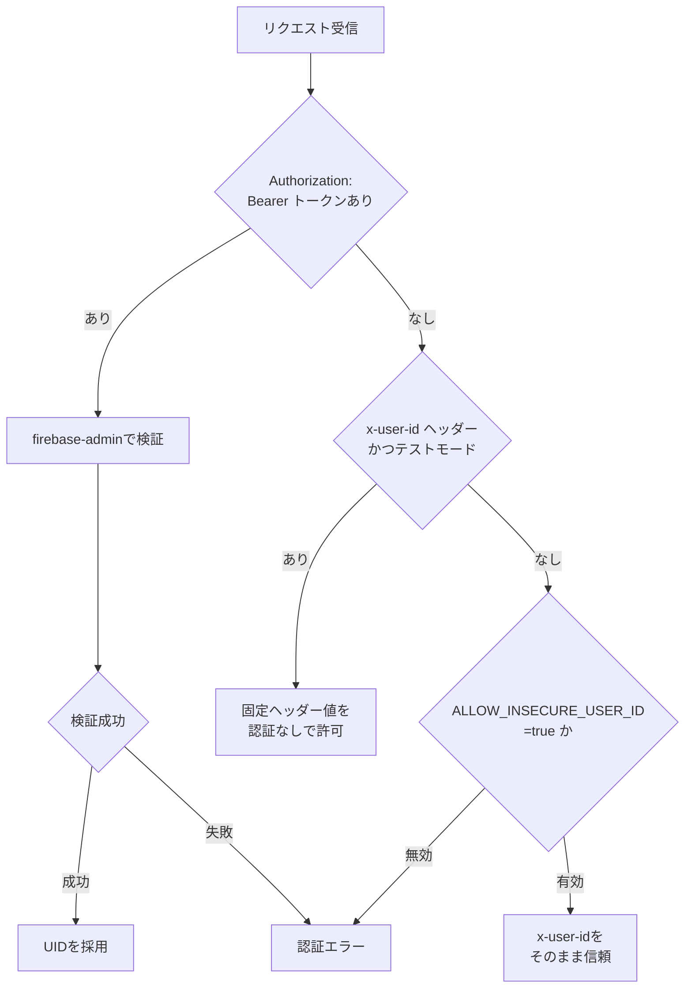
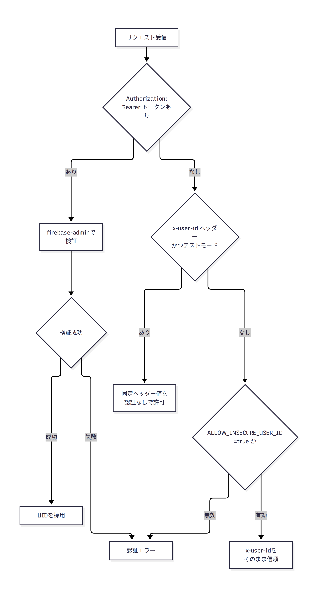

# Firebase Authentication + API Gateway/Lambda(OSLS) + DynamoDBによるバックエンドAPIパターン

GitHub Pages等の静的ホスティングで配信するSPAを対象とする。専用の認証プロキシ層（[`serverless-static-site-pattern.md`](serverless-static-site-pattern.md)のLambda@Edge構成）を持たない構成である。フロントエンドが直接IdP（Firebase Authentication）のID Tokenを取得し、バックエンドAPI側でその都度検証する。uchi-stock（[bamiyanapp/uchi-stock](https://github.com/bamiyanapp/uchi-stock)）がベースである。そこからプロダクト固有の業務ロジック（在庫管理等）を除いた。他プロダクトでも再利用できるバックエンドAPI・認証・CI/CDの構成部分を切り出したものである。

対象は、家族・チーム等の限定的な範囲で使う小規模なWebプロダクト（[`standard-tech-stack.md`](standard-tech-stack.md)と同様）。**フロントエンドの配信方式・UIフレームワークは対象外**である。uchi-stockはGitHub Pages配信・Bootstrap構成だが、これらは他プロダクトのReact/Vite/daisyUI構成と独立に選択できる。ログインなしで使えるアプリの場合や、[`serverless-static-site-pattern.md`](serverless-static-site-pattern.md)のようにサイト全体をログイン必須にしたい場合を考える。そちらのCognito + Lambda@Edge構成を検討すること。本パターンは「フロントエンド自体は誰でも閲覧でき、API呼び出し単位で認証する」構成に向く。

## 全体構成

| コンポーネント | 役割 |
|---|---|
| フロントエンド | 静的ホスティング（GitHub Pages等）で配信するSPA。Firebase Authentication SDK（Google SSO等）でログインし、取得したID TokenをAPIリクエストの`Authorization: Bearer <token>`ヘッダーに載せる |
| バックエンドAPI | API Gateway（REST API）+ AWS Lambda（`osls`でデプロイ、詳細は後述）。各ハンドラーで`firebase-admin` SDKによりID Tokenを検証し、UIDを取得する |
| データストア | DynamoDB（`PAY_PER_REQUEST`、アクセスが無い間の実行コストがゼロに近い） |

専用の認証プロキシ・セッションCookie管理を持たないため、[`serverless-static-site-pattern.md`](serverless-static-site-pattern.md)のような2スタック分割・循環依存の解消手順は不要。バックエンドAPIは単一のServerless serviceとして構築できる。

## PWA（ホーム画面追加）でのセッション永続化（iOS Safari ITP対策）

Firebase Authenticationはセッション状態をIndexedDBへ永続化する。しかしホーム画面に追加したPWA（standalone表示）には注意点がある。iOS SafariのITP（Intelligent Tracking Prevention）により消去されることがある。一定期間操作が無いとIndexedDB・localStorage等のスクリプト書き込み可能なストレージが対象になる。これに巻き込まれ、ログインセッションが意図せず切れる（uchi-stock issue #326）。

フロントエンドの初期化時に以下の対策を組み合わせる。

- `setPersistence(auth, browserLocalPersistence)`を明示的に呼び、Firebase Authのセッション永続化方式を確実に`local`にする
- `navigator.storage.persist()`でブラウザに永続ストレージを要求し、上記の自動消去対象になりにくくする（Safari 15.2+でサポート）。未対応環境ではAPI自体が存在しないため、呼び出し前に`navigator.storage?.persist`の存在チェックを行うフィーチャー検出が必須。付与されるかはブラウザの裁量であり確実な保証ではない

いずれもiOS Safariの内部実装に依存する挙動である。そのためサンドボックス環境やデスクトップブラウザでは再現・検証できず、実機（ホーム画面に追加したPWA、日を跨いだ放置後の起動）での確認が必要になる。

## ユーザー識別ロジック（優先順位）

バックエンドの各ハンドラーは、以下の優先順位でユーザーIDを特定する。

1. **Firebase ID Token**: `Authorization: Bearer <token>`ヘッダーから取得。`firebase-admin` SDKでトークンを検証しUIDを取得する。本番運用ではこれが必須経路
2. **テストモード**: 固定ヘッダー（例: `x-user-id: test-user`）が指定されている場合、認証なしでのアクセスを許可する。ログイン未済のユーザーが機能を試用するデモモード等に使う
3. **開発用fallback**: `x-user-id`ヘッダーをそのまま信頼する経路。開発・ローカルテストの利便性のためのみに存在し、環境変数（例: `ALLOW_INSECURE_USER_ID=true`）で明示的に有効化しない限り無効にする

`FIREBASE_SERVICE_ACCOUNT`環境変数にサービスアカウントキーのJSON文字列を設定し、Lambda実行環境で`firebase-admin`を初期化する。

テストモード（`x-user-id: test-user`）は**読み取り専用にする**。書き込みまで許すと、URLを知る誰もが共有領域を書き換えられ、書き込み量にも上限が無くなる。書き込み系のハンドラーの先頭で、解決したユーザーIDがテストユーザーなら403を返す。ローカル開発（2・3の環境変数が有効な場合）は除く。

## フロントエンドでのID Tokenの扱い

**ID Tokenをstate等へ保持せず、APIを呼ぶたびに`getIdToken()`で取得する**。有効期限は約1時間で、`onAuthStateChanged`はトークンの更新では発火しない。ログイン時に取得した値を使い続けると、アプリを開いたまま1時間が経った後、またはバックグラウンドから復帰した後に、全APIが401になる。画面には「データが無い」ように見え、ログインが切れたと誤認しやすい（uchi-stock、[#716](https://github.com/bamiyanapp/uchi-stock/issues/716)）。

- `getIdToken()`は、失効が近いトークンをSDKが自動で更新して返す。呼び出しのコストは小さい
- 401を受けたら、`getIdToken(true)`で強制更新し、**1回だけ**再試行する。再試行後も401なら、ログインし直しを促す
- `UserContext`へ`idToken`を持たせるのではなく、`getIdToken`関数だけを渡す。コンポーネントが`idToken`を直接参照すると、この誤りを再び入れやすい

ユーザー識別ロジックのフロー（mermaid図）

## OSLS（Open Serverless）の採用

Serverless Framework（`serverless`パッケージ）はv4.0以降ライセンス体系が変更され、一定規模を超える商用利用に有料サブスクリプションが必要になった。v3系のままオープンソースで開発が継続されている後継/フォークプロジェクトが**OSLS**である（npmパッケージ名`osls`）。パッケージ本体は[oss-serverless/osls](https://github.com/oss-serverless/osls)である。これへ切り替えることで、このライセンス制約を回避する。

- `osls`パッケージは`serverless`・`sls`・`osls`の3つのbinエイリアスを提供する**v3の drop-in代替**である。そのため既存の`serverless.yml`（v3スキーマ）・`npx serverless ...`系の呼び出しは無変更のまま動作する
- `package.json`の`devDependencies`で`serverless`を`osls`（`^3.x`系、v3スキーマ互換）に置き換えるだけで移行できる
- Serverless Framework v4への追従（ライセンス制約を受け入れる）が許容できないプロダクトでは、新規構築時から最初に`osls`を選択するとよい

## CIのNode.jsバージョンとLambdaランタイムを一致させる

`reusable-ci.yml`の`node_version`（lint/testで使うNode.jsバージョン）がある。これとLambdaの`provider.runtime`（`serverless.yml`）は、意図的に同じメジャーバージョンへ揃える運用にする。

- CIで検証したNode.jsバージョンと実際のデプロイ先ランタイムが乖離すると、CIでは検知できないランタイム差異のリスクが生まれる。例えば、新しいNode.jsバージョンでのみ利用可能なビルトインAPIを使ったコードが、CIでは通るのに実際のLambda実行環境では動かないことがある
- AWS Lambdaは定期的に古いランタイム（例: `nodejs18.x`）のサポートを終了する。依存パッケージ側が`engines.node`で新しいNode.jsバージョンを要求するようになった場合（`npm warn EBADENGINE`が出る）も含め、両者を同時に見直すタイミングの合図にする
- 見直す際は、`ci.yml`の`node_version`と`serverless.yml`の`runtime`を同一PRで一緒に変更する。CIのfrontend-test/backend-testが新バージョンで成功することを確認してからマージする

## Lambdaでは`require(esm)`が既定で無効である（`firebase-admin` 14以降）

`firebase-admin` 14以降は、次の設定が必須である。`serverless.yml`の`provider.environment`へ、`NODE_OPTIONS: --experimental-require-module`を書く（[#1485](https://github.com/bamiyanapp/dev-standards/issues/1485)）。

依存の連鎖は、`firebase-admin` 14 → `jwks-rsa` 4.x → `jose` 6（ESM専用）である。`jwks-rsa`は、CommonJSから`require("jose")`で読み込む。Node.js本体は、v22.12以降で`require(esm)`が既定で有効である。しかし、Lambdaのマネージドランタイムは、Node 22・24とも既定で無効である。ランタイムを上げても直らない。

実際のLambdaで、デプロイ済みと同じzipを、使い捨ての関数に載せて検証した結果は、次のとおりである。

| ランタイム | 環境変数 | 結果 |
|---|---|---|
| nodejs22.x | なし | `ERR_REQUIRE_ESM`で起動失敗 |
| nodejs24.x | なし | `ERR_REQUIRE_ESM`で起動失敗 |
| nodejs22.x | `NODE_OPTIONS=--experimental-require-module` | 正常に動作 |

CIでは見つからない。CIのNode.js（22.12以上）は、`require(esm)`が有効で、テストが通る。`serverless package`も成功する。「CIのNode.jsとLambdaランタイムのバージョンを揃える」指針でも防げない。バージョンが同じでも、`require(esm)`の既定値が違うためである。

検知には、`deploy-serverless`の`verify-package`を使う。`scripts/verify-lambda-package.js`は、CommonJSのハンドラを、子プロセスで読み込む。このとき、Lambdaと同じ規則（`--no-experimental-require-module`）にする。`serverless.yml`に`NODE_OPTIONS`の指定があれば、Lambdaと同じく、そのフラグを付ける（[`reusable-workflows-reference.md`](reusable-workflows-reference.md)）。

## デプロイ運用（`reusable-cd.yml`を使わない場合）

`reusable-cd.yml`は「`base_branch`→`release_branch`の同期・`release_branch`上でのリリース」を前提とした構成である。semantic-releaseを`base_branch`（`main`）に対して直接実行する運用（`.releaserc.cjs`の`branches: ["main"]`）を選ぶプロダクトでは前提が一致しない。この場合`cd.yml`はプロダクト固有のワークフローとして自前で維持し、`reusable-ci.yml`のみを利用する。

- semantic-releaseの実行・CHANGELOG生成をする。GitHub Pagesへのフロントエンドデプロイ（[`cicd-pipeline-specification.md`](cicd-pipeline-specification.md)の`deploy-github-pages`複合action）がある。Lambdaへのバックエンドデプロイ（`osls deploy`）もある。それぞれ独立したjobとして`cd.yml`に定義する
- Lambdaデプロイ前にDynamoDBの破壊的変更チェック・バックアップを行う運用にする場合を考える。`FORCE_DEPLOY`のような手動フラグで例外的に強行できるようにしておく。これにより、意図した破壊的変更（テーブル構造の変更等）まで機械的にブロックしてしまう事故を避けられる

## 必要なGitHub Secretsの例

| 名前 | 用途 |
|---|---|
| `AWS_ACCESS_KEY_ID` / `AWS_SECRET_ACCESS_KEY` | GitHub ActionsからAWSリソースを操作するIAMユーザーの認証情報（Organizationで設定済み。参照側での個別登録は不要。[`cicd-pipeline-specification.md`](cicd-pipeline-specification.md)「共通の環境変数」参照） |
| `FIREBASE_SERVICE_ACCOUNT` | Firebaseサービスアカウントキー（JSON文字列）。Lambda環境変数として渡す |
| `VITE_USER_POOL_ID`等 | フロントエンドのFirebase設定値（プロジェクトIDやAPIキー等、Viteの`VITE_`prefix環境変数としてビルド時に埋め込む） |

## 実例

uchi-stock（`bamiyanapp/uchi-stock`）の`backend/`（`handler.js`・`serverless.yml`）が本パターンの実装例である。`.github/workflows/cd.yml`も同様に実装例である。
