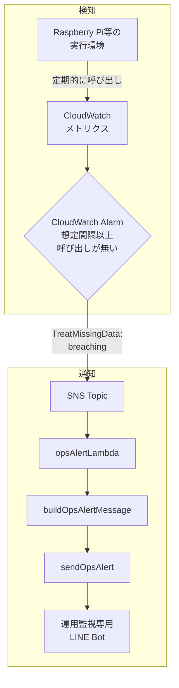
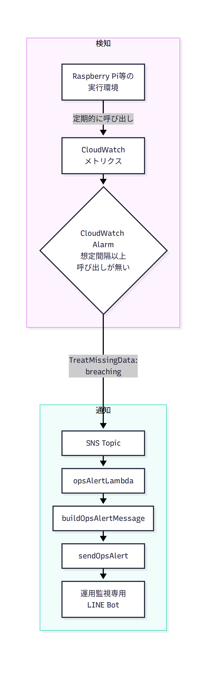

# 運用監視（サイレント障害検知）パターン（`shared/lambda/opsAlertNotifier.js`）

バックエンド以外の実行環境（自宅Raspberry Pi等）が完全に停止・クラッシュした場合を考える。AWS側には一切ログもリクエストも残らないため、通常のエラーログ監視では気づけない（youtube-radar issue #122由来）。CloudWatch Alarmで「想定間隔以上、期待するリクエスト/イベントが発生していない」こと自体を異常として検知する。SNS経由でLambdaを起動する。運用監視専用のLINE Bot（各プロダクトのユーザー向け通知Botとは別に、全プロダクト共通で1つ新規開設したもの）へ通知する。

<details>
<summary>CloudWatch→LINE通知フロー（mermaid図）</summary>



</details>



**このファイル自体はnpmパッケージを`require`しない**（symlink経由で共有する場合の制約は[`daily-rate-limit-pattern.md`](daily-rate-limit-pattern.md)参照）。SNSイベントのパース等、実際のLambdaハンドラの実装は呼び出し側に委ねる。

## 使い方

呼び出し側（プロダクトのbackend）でLambdaハンドラを実装する。

```js
// backend/src/opsAlertLambda.js（ESMプロジェクトの例）
import { buildOpsAlertMessage, sendOpsAlert } from "./opsAlertNotifier.js"; // symlink先

export async function handler(event) {
  for (const record of event.Records ?? []) {
    const alarm = JSON.parse(record.Sns.Message);
    const message = buildOpsAlertMessage({
      appName: "youtube-radar",
      alarmName: alarm.AlarmName,
      newState: alarm.NewStateValue,
      reason: alarm.NewStateReason,
    });
    await sendOpsAlert({
      message,
      channelAccessToken: process.env.OPS_ALERT_LINE_CHANNEL_ACCESS_TOKEN,
      userId: process.env.OPS_ALERT_LINE_USER_ID,
    });
  }
}
```

## serverless.ymlでの組み込み例

「想定間隔以上、期待するLambda（例: 定期的にポーリングを行うクライアントから呼ばれるAPI）の呼び出しが無い」ことを検知する例。`TreatMissingData: breaching`（メトリクス自体が存在しない＝呼び出しが無い状態を、閾値割れと同様に異常とみなす）が要点。

```yaml
resources:
  Resources:
    OpsAlertTopic:
      Type: AWS::SNS::Topic
      Properties:
        TopicName: ${self:service}-${sls:stage}-ops-alert

    TranscriptApiNoInvocationsAlarm:
      Type: AWS::CloudWatch::Alarm
      Properties:
        AlarmName: ${self:service}-${sls:stage}-transcriptApi-no-invocations
        Namespace: AWS/Lambda
        MetricName: Invocations
        Dimensions:
          - Name: FunctionName
            Value: ${self:service}-${sls:stage}-transcriptApi
        Statistic: Sum
        # 想定実行間隔（例: cronで10分ごと）に対して十分な余裕を持たせる。
        # 短すぎると正常な間隔のばらつきで誤検知する
        Period: 3600
        EvaluationPeriods: 1
        Threshold: 1
        ComparisonOperator: LessThanThreshold
        TreatMissingData: breaching
        AlarmActions:
          - !Ref OpsAlertTopic

functions:
  opsAlert:
    handler: src/opsAlertLambda.handler
    environment:
      OPS_ALERT_LINE_CHANNEL_ACCESS_TOKEN: ${env:OPS_ALERT_LINE_CHANNEL_ACCESS_TOKEN}
      OPS_ALERT_LINE_USER_ID: ${env:OPS_ALERT_LINE_USER_ID}
    events:
      - sns:
          arn: !Ref OpsAlertTopic
```

## 導入時の確認事項（デプロイ側）

`shared/lambda/*.js`をsymlinkで使う場合、デプロイ側で次を確認する。2つのプロダクトで、本番APIが約10日間止まった（#1386）。

- **デプロイジョブのチェックアウトに、`submodules: true`を指定する**。無いと、symlinkの実体が存在しない。`serverless package`は成功するが、zipにファイルが含まれない。デプロイ後、全関数が`Cannot find module`で起動に失敗する。CIは`submodules`ありで動くため、検知できない
- `deploy-serverless`複合actionは、デプロイ前にリンク切れのsymlinkを検知し、あれば失敗させる（`check-broken-symlinks`、既定で有効）
- **通知用Secretsを、デプロイステップの`env`へ渡す**。`serverless.yml`の`${env:OPS_ALERT_LINE_CHANNEL_ACCESS_TOKEN}`は、デプロイ時の環境変数から解決される。渡していないと、通知が常にスキップされる
- 生成したパッケージを展開し、ハンドラを読み込めることを検証する。`deploy-serverless`の`verify-package: true`で、デプロイ前に実行できる（`scripts/verify-lambda-package.js`）。`verify-package-forbid`でテストファイル等の混入も検出できる
- `deploy-serverless`を使わず、`cd.yml`で`npx serverless deploy`を直接呼ぶ場合は、`verify-lambda-package.js`を自分で呼ぶ。**呼び出し順は、`npx serverless package`、`verify-lambda-package.js`、`npx serverless deploy`である**。zip（`.serverless/<サービス名>.zip`）は、`serverless package`が作る。zipが無いと、スクリプトは、先に`serverless package`を実行するよう案内して、終了コード2で終わる（[#1573](https://github.com/bamiyanapp/dev-standards/issues/1573)）
- CDの失敗を通知する。CDの最後に、`if: failure()`のjobで`notify-cd-failure`複合actionを呼ぶ。固定タイトルのissueへコメント（無ければ起票）し、LINEのトークンがあればLINEにも送る。スマートフォンのGitHubアプリへ通知が届く
- デプロイ後に、実際のAPIへ疎通確認する。`deploy-serverless`の`smoke-test-url`で、GETして200以外なら失敗させる。E2EがAPIをモックしている構成では、デプロイされたバックエンドの異常を、これ以外に検知できない

## Lambdaのエラーを検知するアラーム

### Errorsアラームの限界

`AWS/Lambda`の`Errors`は、ハンドラが例外を外へ投げたときにしか増えない。API用のLambdaは、例外を捕捉して500や502を返す実装が一般的である。その場合、`Errors`は増えない。**`Errors`アラームだけでは、利用者に見えている失敗を検知できない**。次の5xxアラームと併用する。

### API Gatewayの5XXErrorアラーム

```yaml
    ApiGateway5xxAlarm:
      Type: AWS::CloudWatch::Alarm
      Properties:
        AlarmName: ${self:service}-${sls:stage}-api-5xx
        Namespace: AWS/ApiGateway
        MetricName: 5XXError   # HTTP APIは5xx（名前が異なる）。実際のメトリクス名を確認する
        Dimensions:
          - Name: ApiName
            Value: ${self:service}-${sls:stage}
        Statistic: Sum
        Period: 300
        EvaluationPeriods: 1
        Threshold: 1
        ComparisonOperator: GreaterThanOrEqualToThreshold
        TreatMissingData: notBreaching
        AlarmActions:
          - !Ref OpsAlertTopic
```

API種別（REST API・HTTP API）で、メトリクス名とディメンションが異なる。生成されたテンプレートと、CloudWatchのメトリクス一覧で確認する。

### 関数ごとの重複定義を避ける

関数ごとにほぼ同じ`AWS::CloudWatch::Alarm`を手書きすると、重複が増える。関数を追加するときに、追加を忘れることもある。`shared/lambda/errorAlarms.js`の`buildErrorAlarms()`で、`functions`のキー一覧から生成する。関数を足したとき、アラームも自動で増える。

```js
// alarms.js（serverless.ymlの `resources: ${file(./alarms.js)}` から読み込む）
const { buildErrorAlarms } = require("./errorAlarms.js"); // symlink先
module.exports = (serverless) =>
  buildErrorAlarms({ functionNames: Object.keys(serverless.service.functions), alarmActionTopic: "OpsAlertTopic", exclude: ["opsAlert"] });
```

- 追加の依存は無い。Serverless Frameworkのプラグインは、サプライチェーンの面で採用しない
- `TreatMissingData: notBreaching`である。呼び出しが無い間はエラーも無い。「呼び出しが無いこと」の検知（上の`Invocations`と`breaching`）とは、使い分ける

## 通知先

- LINE公式アカウントを用意できるまでの暫定として、SNSのEmail購読を使える。**確認メールのリンクを開くまで、購読は有効にならない**。デプロイが成功しても、通知が届くことは意味しない
- 本番の通知先は、運用監視専用のLINE Botである（次の節）

## Lambda@Edgeの監視

Lambda@Edgeは、実行リージョンごとに関数のレプリカが作られる。レプリカの名前は`us-east-1.<関数名>`である。`AWS/Lambda`のメトリクスは、リージョンごとに分かれる。全リージョンにアラームを張るのは現実的でない。

そこで、`AWS/CloudFront`名前空間のメトリクスを使う。ディストリビューション単位で、`us-east-1`に集約して出る。一時workflowで`aws cloudwatch list-metrics`を実行して確認した（確認日: 2026-11-21）。

- 次のメトリクスが存在する。ディメンションは`DistributionId`と`Region`である
  - `4xxErrorRate`・`5xxErrorRate`・`TotalErrorRate`
  - `Requests`・`BytesDownloaded`・`BytesUploaded`
  - `LambdaLimitExceededError`
- CloudFront Functionsのメトリクスもある。`FunctionInvocations`・`FunctionComputeUtilization`・`KvsReadRequests`である。ディメンションは`DistributionId`・`FunctionName`・`Region`である
- `LambdaExecutionError`・`LambdaValidationError`は、一覧に無かった。エラーが無い間は、メトリクス自体が出ないと考えられる。存在は未確認である
- 実行リージョン側の`AWS/Lambda`は、`us-east-1`と`us-west-2`に40系列ずつあった。`eu-west-1`と`ap-northeast-1`には無かった。メトリクス名は`Invocations`・`Errors`・`Duration`・`Throttles`・`ConcurrentExecutions`である。リージョンへの分布は、利用者の所在で変わる

アラームの第一候補は、`AWS/CloudFront`の`5xxErrorRate`である。`LambdaLimitExceededError`も使える。追加料金の要否は、未確認である。

## 運用監視専用LINE Botについて

各プロダクトが持つユーザー向け通知用のLINE公式アカウントとは別に、**運用監視専用のLINE公式アカウントを全プロダクト共通で1つ新規開設**する。LINE Developersコンソール（スマートフォンのブラウザから操作可能）から作成し、チャンネルアクセストークンと通知先のユーザーIDを取得する。

GitHub Secrets自体はリポジトリ単位でしか登録できないため、共通化されるのはLINE公式アカウント（と、そこへ送るためのメッセージ組み立て・送信ロジック）のみである。各プロダクトは自身のリポジトリのGitHub Secretsへ登録する。同じ値を`OPS_ALERT_LINE_CHANNEL_ACCESS_TOKEN`・`OPS_ALERT_LINE_USER_ID`として個別に登録する。

メッセージに`appName`を含めているのは、1つのLINE Botに複数プロダクトからの通知が届くため、どのアプリの異常かをひと目で区別できるようにするため。

## 設計上の要点

- `buildOpsAlertMessage`は通知文を組み立てる純粋関数である。CloudWatch AlarmのSNSメッセージ（`AlarmName`・`NewStateValue`・`NewStateReason`）から組み立てる。`sendOpsAlert`はLINE Messaging APIへの送信のみを行う。SNSイベント自体のパース（`event.Records`のループ等）はプロダクトごとのLambdaハンドラに委ねる
- 「異常発生（ALARM）」だけでなく「復旧（OK）」でも同じLambdaが呼ばれるため、`newState`をメッセージに含めることで復旧報告も兼ねる
- CloudWatch Alarmの`Period`・`EvaluationPeriods`は、監視対象の正常な実行間隔のばらつきを考慮する。短すぎて誤検知しない値にする（cronの実行間隔そのものではなく、十分な余裕を持たせた値にする）
